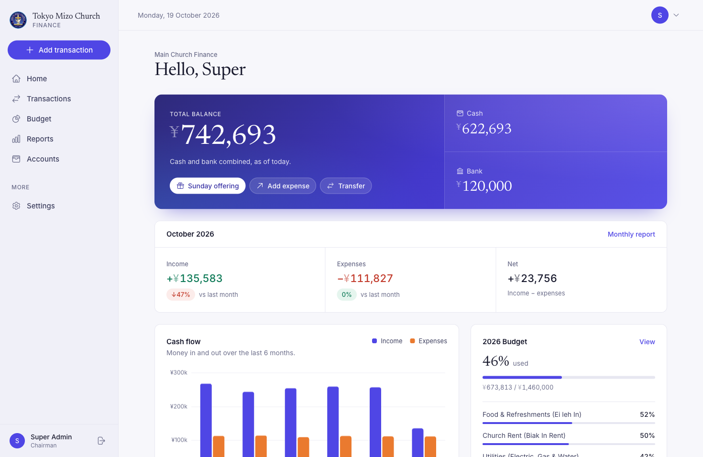

# Tokyo Mizo Church Portal

Tokyo Mizo Church Portal is a finance management app built with Ruby on Rails 8. It helps the church's finance team record income and expenses, print expense vouchers, close months, and export reports.



## Features

* Multi-Unit Finance Management (Income, Expenses, Cash & Bank balances)
* Expense vouchers with printable receipts
* Monthly closing
* PDF & Excel Report Export
* User accounts with per-unit finance access
* Mobile-Friendly Responsive Design (installable as a PWA)

## User Roles

* Super Admin
* Pastor
* Adviser
* Secretary
* Treasurer
* Member

## Finance Units

The portal keeps each ministry ledger separate while retaining one shared login
and administration area. The default units are Main Church Finance, Naupang
Department, Thalai Department, Hmeichhe Department, Building Sum, and Mission
Sum.

President and Secretary accounts can oversee every unit, assign unit-specific
finance roles, and export a consolidated report. Church and department units
support Treasurers, Finance Secretaries, and Viewers; Building Sum and Mission
Sum use a Treasurer (plus optional read-only Viewers). Unit managers can update
only their assigned ledgers. Existing finance records are assigned to Main
Church Finance automatically when the multi-unit migration runs.

## Technology Stack

* Ruby on Rails 8
* SQLite (single file, no database server)
* Hotwire (Turbo & Stimulus)
* Tailwind CSS
* Devise Authentication
* Prawn PDF
* Axlsx Excel Export

## Local Setup

Clone the repository:

```bash
git clone git@github.com:thadomaloma/tokyo-mizo-church-portal.git
cd tokyo-mizo-church-portal
```

Install dependencies:

```bash
bundle install
```

Create and prepare the database:

```bash
bin/rails db:prepare
```

Create the first admin account:

```bash
SEED_ADMIN_EMAIL=admin@tokyomizochurch.org \
SEED_ADMIN_PASSWORD='<use-a-long-unique-password>' \
SEED_ADMIN_NAME="Super Admin" \
bin/rails db:seed
```

Start the app:

```bash
bin/dev
```

Open:

```text
http://localhost:3000
```

The seed password is applied only when the account is first created. To rotate it
intentionally, set `RESET_SEED_ADMIN_PASSWORD=true` for one seed run and then
remove that variable.

## Production Setup

Everything the app stores lives under `storage/`: the SQLite database
(`storage/production.sqlite3`, or `DATABASE_PATH`) and uploaded receipts. Run
the Docker image on any small server with that folder mounted as a persistent
volume at `/rails/storage` (`config/deploy.yml` already does this for Kamal).
The entrypoint runs `db:prepare` on boot.

Required variables:

* `SECRET_KEY_BASE` or `RAILS_MASTER_KEY`
* `APP_HOST` (the public host name, used in password reset emails)
* `GMAIL_USERNAME`, `GMAIL_APP_PASSWORD`, and optionally `MAILER_FROM`
* `SOLID_QUEUE_IN_PUMA=true` so background jobs run inside the web process

Back up the whole `storage/` folder: it holds both the database and receipts.

Do not keep `SEED_ADMIN_PASSWORD` set after the first successful seed.

### Moving data off the old PostgreSQL database

`bin/rails db:import_from_postgres` copies users, finance units, categories,
transactions, periods, audits and receipt records from `SOURCE_DATABASE_URL`
into an empty SQLite database. See `lib/tasks/import_from_postgres.rake` for the
exact steps. Receipt files must be copied from the old volume into `storage/`
separately.

## Purpose

The portal is designed to keep the church's finances accurate and transparent while staying simple and cheap to run.

Developed for Tokyo Mizo Church, Japan.
