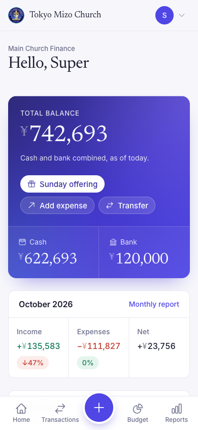

# Tokyo Mizo Church Finance

The finance app of Tokyo Mizo Church, Japan. The church's finance team records
Sunday offerings, income and expenses, prints expense vouchers, closes each
month and exports reports, from a laptop or a phone.

<p>
  
  &nbsp;
  
</p>

Version 2.0 · Built with Ruby on Rails 8 and SQLite · Developed by Maloma Thado

## What it does

**Recording**

* Income, expenses and transfers between Cash and Bank. Transfers move money
  between accounts and never count as income or expense.
* Sunday offering form: every giving category on one screen, totalled as you type.
* Expense vouchers numbered per year (EXP-2026-0001, …) and printable as an A5
  payment voucher with the amount in words and signature lines.
* Change history on every transaction (who changed what, and when).

**Overview**

* Home: total balance, Cash and Bank, this month against last month, cash
  flow and spending-pace charts, budget progress and recent activity.
* Accounts: balance over time and each account's money in and out.
* Yearly budget per expense category, with progress through the year.

**Month end and reports**

* Monthly statement with opening and closing balances. Closing a month locks
  its entries until someone who manages the unit reopens it.
* Reports for any range of months: by category, by month, tithe and offering.
  Download as PDF or Excel. Admins can also report on all units together.

**Finance units**

The Main Church Finance ledger exists from the start. Departments and funds
(for example a building or mission fund) can be added in Settings when they
start keeping their own money; each has its own ledger, categories and
vouchers.

**Phones**

* Installable on the Home Screen (PWA), with an offline page.
* Bottom navigation bar with a central "Add transaction" button; larger text,
  fixed 100% zoom.

## Who can do what

| Role | Access |
| --- | --- |
| **Chairman**, **Secretary** | Everything: all units, users, finance units, backups |
| **Treasurer**, **Finance Secretary** | Per unit, as assigned in Settings → Finance units & access |

Within a unit, a person is a **Treasurer** or **Finance Secretary** (can add,
edit and delete entries, close and reopen months, edit budgets) or a
**Viewer** (read only). Records of other units stay hidden.

## Security and backups

* Sign-in is limited to 10 attempts per IP address in 3 minutes, and password
  reset requests to 5 in 15 minutes.
* Ten wrong passwords lock an account for an hour. The Chairman or Secretary
  can unlock it sooner by saving the user in Settings.
* A Content Security Policy only lets the app's own scripts run. HTTPS only;
  passwords need at least 12 characters.
* Closed months cannot be changed, and every transaction keeps an audit trail.
* **Backups** of the whole database, gzipped and encrypted with
  `BACKUP_PASSPHRASE`, are uploaded to a Cloudflare R2 bucket, so a copy
  always lives outside the server:
  * every night at 11pm (Tokyo) when finance records changed that day;
  * every Sunday at 11pm regardless, so there is a copy at least weekly;
  * whenever an admin presses "Send backup now" in Settings.

  Settings shows whether backups are on and when the last one was taken.
  The copy is taken on its own connection, so people can keep working, and a
  copy that did not finish is never uploaded.

### Opening and restoring a backup

Download the file from the bucket in the Cloudflare dashboard (R2 → the
bucket → the newest `tmc-backup-YYYY-MM-DD-HHMM.sqlite3.gz.enc`), then on any
computer with OpenSSL:

```sh
openssl enc -d -aes-256-cbc -pbkdf2 -iter 600000 -md sha256 \
  -in tmc-backup-YYYY-MM-DD-HHMM.sqlite3.gz.enc -out backup.sqlite3.gz
gunzip backup.sqlite3.gz
```

To restore, upload `backup.sqlite3` to the server's volume as
`production.sqlite3` (on Railway: `railway volume files upload … --overwrite`)
and redeploy.

## Technology

* Ruby 4.0, Rails 8.1
* SQLite: one database file holds records, cache and background jobs; no
  database server
* Hotwire (Turbo and Stimulus), importmap, Tailwind CSS 4
* Devise (sign-in, password reset, lockout), audited (change history)
* Prawn (PDF), caxlsx (Excel), Chart.js (charts)
* Solid Queue (backups and other background jobs) and Solid Cache
* Minitest and Capybara; CI runs tests, browser tests, RuboCop, Brakeman,
  bundler-audit and importmap audit on every push

## Running it locally

```sh
git clone git@github.com:thadomaloma/tokyo-mizo-church-portal.git
cd tokyo-mizo-church-portal
bundle install
bin/rails db:prepare
SEED_ADMIN_EMAIL=you@example.com \
SEED_ADMIN_PASSWORD='<a long unique password>' \
SEED_ADMIN_NAME="Your Name" \
bin/rails db:seed
bin/dev
```

Open <http://localhost:3000> and sign in with the seed account (a Chairman).
The seed password is only applied when the account is first created; to change
it on purpose, run the seed once with `RESET_SEED_ADMIN_PASSWORD=true`.

Run the checks CI runs:

```sh
bin/rails test test:system
bin/rubocop
bin/brakeman
```

## Deploying

The app is one Docker image and one persistent folder, `/rails/storage`, which
holds the SQLite database. On boot the entrypoint runs `db:prepare`, which
applies any new migrations.

It runs on Railway: pushing to `main` deploys, and `.railway/railway.ts`
describes the service and its volume (preview changes with
`railway config plan`). Any host that can run a container with a persistent
volume works the same way.

Variables:

| Variable | Purpose |
| --- | --- |
| `RAILS_MASTER_KEY` or `SECRET_KEY_BASE` | Rails secrets |
| `APP_HOST` | Public host name for links in emails (falls back to Railway's domain) |
| `GMAIL_USERNAME`, `GMAIL_APP_PASSWORD` | Password reset emails (optional `MAILER_FROM`). Railway's Hobby plan blocks SMTP, so these only work on Pro or another host |
| `SOLID_QUEUE_IN_PUMA=true` | Run background jobs inside the web process |
| `BACKUP_PASSPHRASE` | Encrypts backups; keep it in a password manager. No passphrase, no backups |
| `R2_ACCOUNT_ID`, `R2_ACCESS_KEY_ID`, `R2_SECRET_ACCESS_KEY`, `R2_BUCKET` | The Cloudflare R2 bucket for backups (an API token with Object Read & Write on that bucket only) |

Never set `DATABASE_URL`: the app refuses to start with it, so a linked
database cannot replace the SQLite file by accident. Do not leave
`SEED_ADMIN_PASSWORD` set after the first seed.
